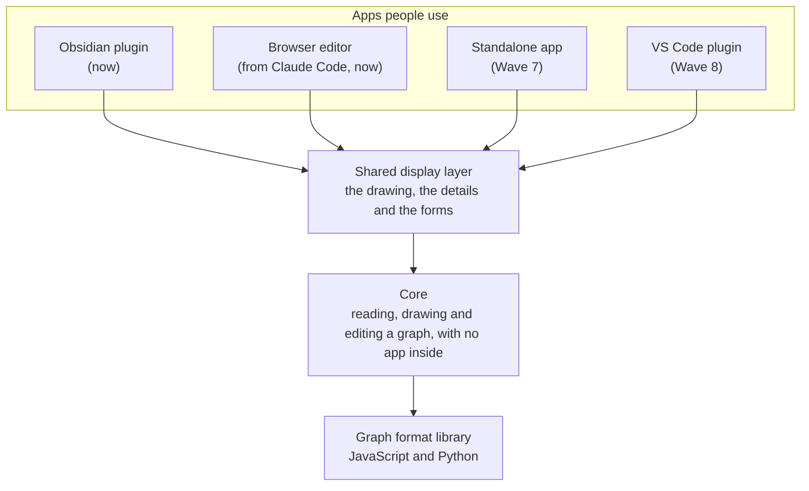

# Architecture

Graph Note is built in layers. Each layer only uses the ones below it, so a new app can be added on top without
changing what is underneath.

| Layer | What it does | Where it is described |
|---|---|---|
| Graph format library | Reads a graph written in a note and checks it against the rules | [graph-spec guide](https://github.com/rogerbucks/graph-note/blob/main/packages/graph-spec/GUIDE.md), [Python guide](https://github.com/rogerbucks/graph-note/blob/main/python/graph_spec/GUIDE.md) |
| Core | Works out the drawing and the edits, the same in every app | [core guide](https://github.com/rogerbucks/graph-note/blob/main/packages/core/GUIDE.md) |
| Obsidian plugin | Puts the drawing and the editor into Obsidian's notes | [Obsidian guide](https://github.com/rogerbucks/graph-note/blob/main/packages/obsidian/GUIDE.md) |
| Browser editor | Opens the same editor in a browser, from Claude Code | [Claude Code guide](https://github.com/rogerbucks/graph-note/blob/main/packages/claude-code/GUIDE.md) |

The requirements every layer is built to are in
[`requirements/editor-requirements.gql`](https://github.com/rogerbucks/graph-note/blob/main/requirements/editor-requirements.gql).

How ready these layers are for other languages, right-to-left scripts, plug-ins, themes and contract tests, and the
plan to add them, is in the [design review](Design-review).

The whiteboard, a board view for brainstorming with several people that decomposes into graph items, is designed in
the [whiteboard design](Whiteboard-design).

A Copilot Cowork skill, which brings graph notes kept in OneDrive or SharePoint into Microsoft 365 Copilot Cowork, is
designed in the [Copilot Cowork skill design](Copilot-Cowork-skill-design).
